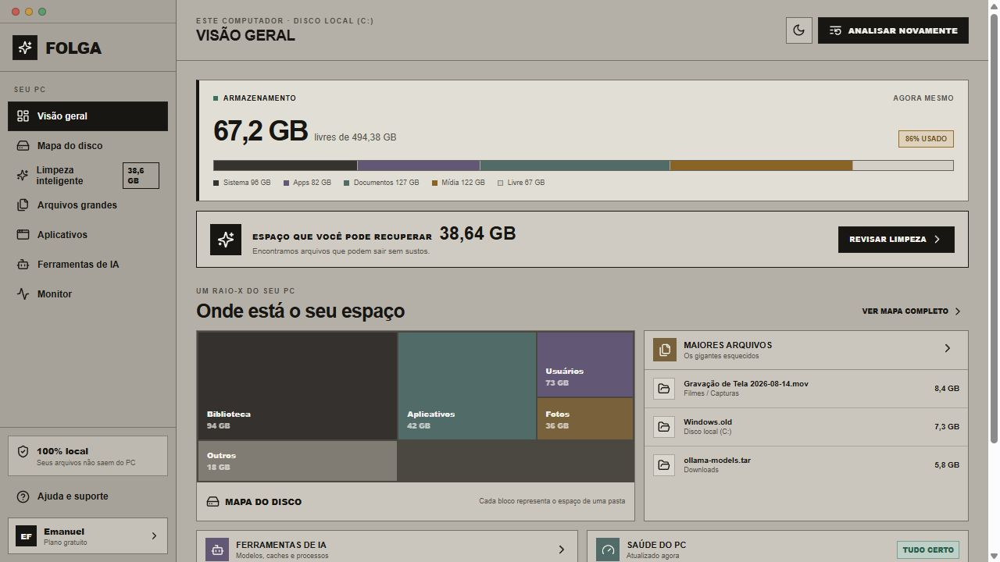
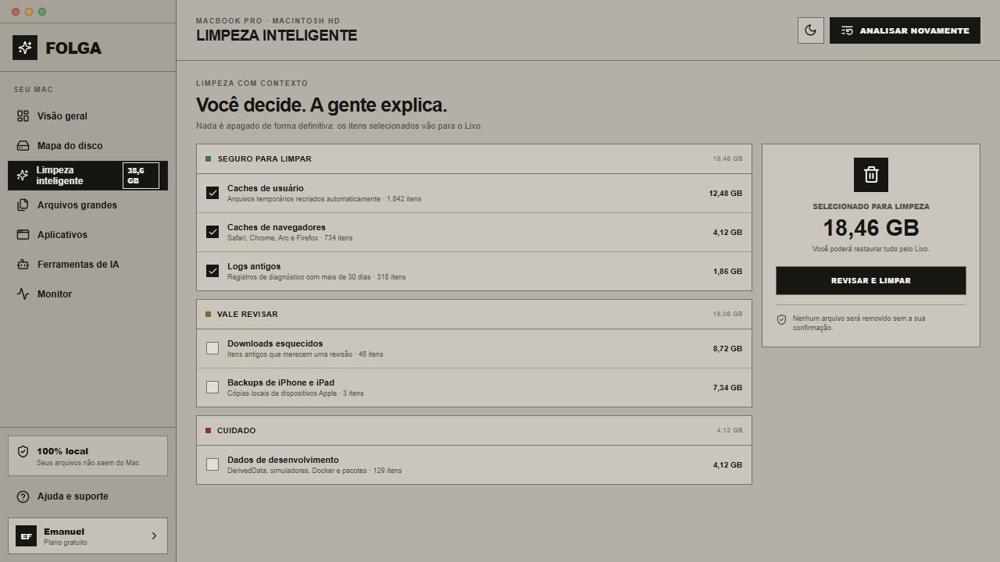
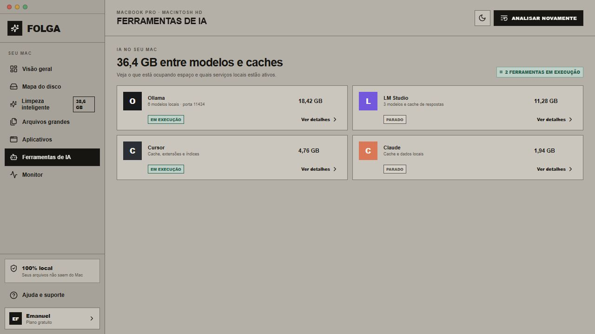
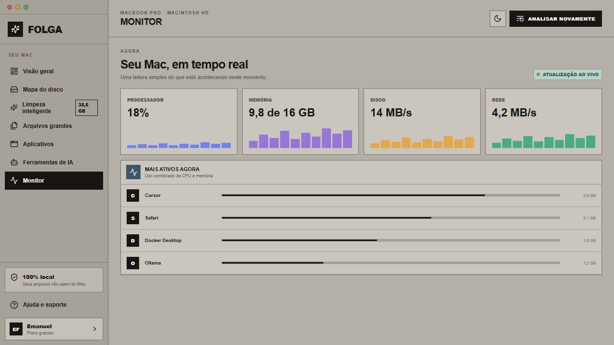

<p align="center">
  
</p>

<h1 align="center">FOLGA</h1>

<p align="center"><strong>Veja o que ocupa espaço. Limpe com contexto.</strong></p>

<p align="center">
  
  
  
  
  
</p>

<p align="center"><strong>FOLGA por MANELZ0RD</strong></p>

O Folga transforma o armazenamento do computador em uma interface visual e compreensível. Ele mostra pastas e arquivos por tamanho, localiza os maiores responsáveis pelo uso do disco, reúne limpezas por nível de risco e monitora recursos do sistema — sem enviar a análise para servidores externos.

**F**erramenta de **O**rganização e **L**impeza com **G**estão de **A**rmazenamento.

> O release completo disponível nesta página é o de Windows. A versão macOS usa a mesma interface e está em teste antes da publicação definitiva.

## Download para Windows

[**Baixar Folga v0.1.7 para Windows**](https://github.com/manelz0rd2/Folga/releases/download/v0.1.7/Folga-0.1.7-Windows-x64.msi)

Abra o MSI e siga o instalador. O Folga será instalado como aplicativo desktop e criará seus atalhos no Windows. Ele não funciona como uma página hospedada e não precisa manter navegador ou servidor local aberto.

O repositório guarda o código-fonte, testes e documentação. O instalador pronto fica anexado à [Release v0.1.7](https://github.com/manelz0rd2/Folga/releases/tag/v0.1.7).

## Visão geral

O Folga só apresenta números depois que você escolhe um disco e inicia a análise. A tela principal resume capacidade, espaço livre, itens que podem ser revisados, maiores arquivos, ferramentas de IA e saúde do computador.



## Mapa do disco

O mapa reúne tudo em uma única interface. Na parte superior, você navega pelas pastas e arquivos e acompanha tamanho, quantidade de itens e porcentagem ocupada. Na parte inferior, cada arquivo ou pasta aparece como um retângulo proporcional ao espaço usado.

Os blocos não exibem texto: as cores agrupam tipos semelhantes e mantêm o mosaico legível mesmo com milhares de arquivos. Ao clicar em um bloco, o Folga abre a pasta correspondente na lista superior e destaca o item representado.

## Limpeza com contexto

As sugestões são divididas entre itens seguros, itens que valem uma revisão e áreas que exigem cuidado. Nada é removido automaticamente. Antes de confirmar, o usuário vê o caminho, a quantidade e o tamanho de cada categoria selecionada.



Os arquivos confirmados são enviados para a Lixeira do Windows ou para o Lixo do macOS. O Folga não usa exclusão definitiva nessa operação.

## Arquivos, aplicativos e ferramentas de IA

- encontra arquivos grandes e permite abri-los no Explorador ou Finder;
- lista aplicativos instalados com seus ícones reais quando o sistema fornece essa informação;
- detecta dados locais de Ollama, LM Studio, Cursor e Claude;
- mostra modelos, caches, arquivos e processos associados às ferramentas encontradas;
- permite escolher qual disco será analisado em computadores com várias unidades.



## Monitor do computador

O monitor acompanha processador, memória e processos em execução, usando os ícones reais dos aplicativos quando disponíveis. A leitura é atualizada sem depender da troca de abas.



## Privacidade e segurança

- a análise acontece localmente e nenhum inventário de arquivos é enviado;
- o usuário escolhe o disco antes de iniciar a leitura;
- nenhuma limpeza começa sem seleção e confirmação;
- itens removidos vão para a lixeira nativa do sistema;
- clicar em um arquivo apenas o localiza ou abre no gerenciador do sistema;
- o instalador não inclui conta, plano ou coleta obrigatória de dados.

## macOS

O Folga já possui integração para caminhos, discos, aplicativos, Lixo e Finder do macOS. O workflow manual `Gerar Folga para macOS` compila e testa o projeto em um runner macOS, produzindo `.app` e `.dmg` como artefatos privados de teste.

O primeiro DMG não será publicado como release enquanto os testes em um Mac real não forem concluídos. Como ainda não há assinatura e notarização da Apple, o macOS pode exigir **botão direito > Abrir** na primeira execução.

Consulte [as instruções do pacote macOS](README-MACOS.md).

## Recursos

- análise sob demanda, sem números fictícios antes do escaneamento;
- seleção de disco em máquinas com várias unidades;
- mapa proporcional inspirado no WinDirStat;
- navegador de pastas e arquivos sincronizado com o mosaico;
- porcentagem de cada item no nível atual;
- blocos agrupados por tipo e cor;
- localização do arquivo ao clicar no bloco correspondente;
- busca de arquivos grandes;
- limpeza explicada e organizada por risco;
- inventário de aplicativos instalados;
- detecção de ferramentas e caches de IA;
- monitor de CPU, memória e processos;
- interface responsiva compartilhada entre Windows e macOS;
- tema claro e escuro;
- feedback e apoio voluntário na tela Sobre o Folga.

## Recursos técnicos

- aplicativo desktop em Tauri 2, Rust, React e TypeScript;
- interface empacotada no executável, sem servidor local em produção;
- MSI Windows x64 com bootstrapper do WebView2;
- pacotes `.app` e `.dmg` gerados nativamente no macOS;
- leitura de discos e métricas com `sysinfo`;
- varredura de arquivos com `walkdir`;
- envio seguro para a lixeira com integração nativa;
- leitura do Registro do Windows para aplicativos instalados;
- extração de ícones reais no Windows;
- comandos específicos por plataforma isolados no backend Rust;
- testes de tipagem, build da interface e regras críticas do backend.

## Desenvolvimento

Requisitos: Node.js 22, pnpm 10, Rust estável e as ferramentas nativas da plataforma.

```bash
pnpm install
pnpm test
pnpm tauri dev
```

Para gerar os pacotes:

```bash
# Windows: MSI em português
pnpm tauri:windows

# macOS: aplicativo e DMG
pnpm tauri:macos
```

## Projeto e colaboração

Consulte o [histórico de versões](CHANGELOG.md), as [orientações para contribuir](CONTRIBUTING.md), a [política de segurança](SECURITY.md) e as [dependências de terceiros](THIRD-PARTY.md).

Este repositório ainda não possui uma licença pública de reutilização. Todos os direitos permanecem reservados a MANELZ0RD até a definição da licença do projeto. As dependências mantêm suas próprias licenças.
